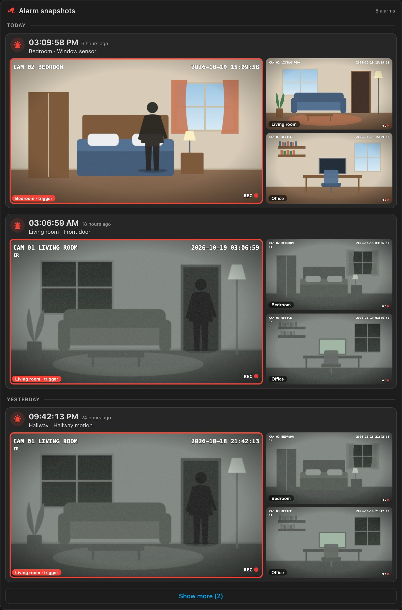
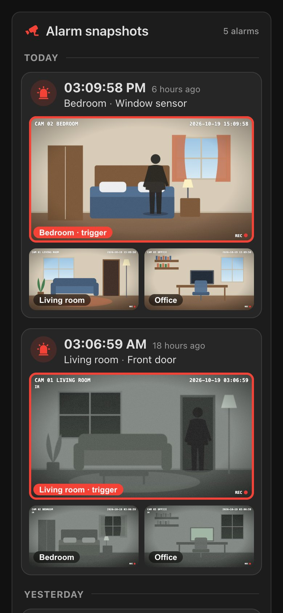
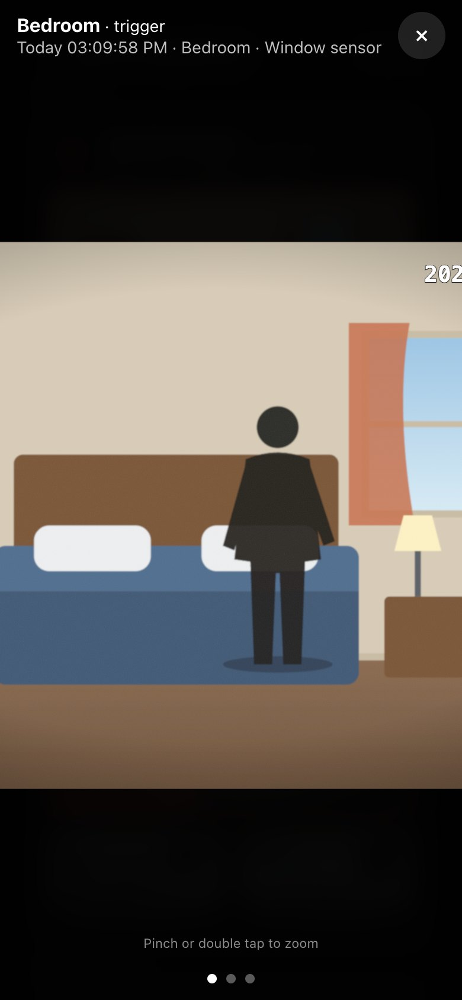
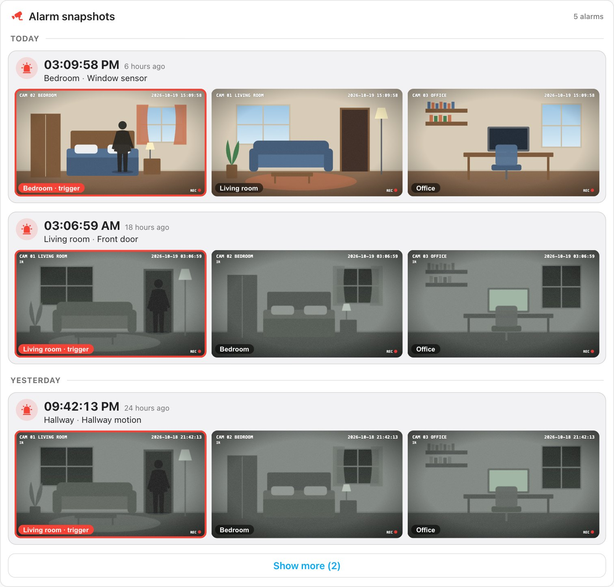

# Alarm Board Card

[![hacs][hacs-badge]][hacs-url]
[![release][release-badge]][release-url]
[![validate][validate-badge]][validate-url]
[![license][license-badge]](LICENSE)

A Home Assistant dashboard card that turns the snapshots taken when your alarm goes off into a
**board you can actually read**: newest first, grouped by day, one block per alarm with the time,
the room and the sensor that triggered it — and the photos already open, the triggering camera
in front.



> The photos in these screenshots are drawn, not real camera footage. Run `npm run screenshots`
> to regenerate them.

## Why

When the alarm goes off you get a push notification with a photo. Then what?

- The photo is gone the moment the notification is gone. A week later, *"what was that alarm on
  Tuesday night?"* has no answer.
- The usual way to attach a photo to a notification is to save it in `config/www`, which Home
  Assistant serves at `/local/...` **without any authentication**. Photos of the inside of your
  home end up on a public URL protected only by an unguessable file name.
- A camera snapshot without context is half the story. *Which* sensor tripped? In which room?

This card reads the snapshots from **your Home Assistant media library** — behind the login,
through short-lived signed URLs — and lays them out by alarm, with the context written into the
folder name by the script that takes them.

## Features

- **One block per alarm** — time, how long ago, room and triggering sensor, then the photos.
- **The triggering camera in front** — large, red frame, labelled; the others beside it. Or an
  even grid, if you prefer.
- **Grouped by day** — *Today*, *Yesterday*, then the date, newest first.
- **Full-screen viewer** made for phones — pinch to zoom up to 5×, double tap to zoom where you
  tap, drag to look around, swipe to the next camera. The Home Assistant app disables page zoom,
  so the viewer does it itself.
- **Private by design** — photos stay in the media library and are loaded through signed URLs
  that expire; nothing is public.
- **Pages** — the first alarms are loaded, the rest on demand, so a long history costs nothing.
- **Refreshes itself** when the snapshot script finishes.
- **Visual editor**, **English and Italian** (follows your Home Assistant language,
  [screenshot](docs/italian.jpg)), light and dark themes, responsive down to a phone.
- No dependencies, no build step.

| Phone | Full-screen, zoomed in | Even grid, light theme |
|---|---|---|
|  |  |  |

## How it works

The card does not take photos: it shows what is in a media folder. Each alarm is a sub-folder,
and **its name carries the metadata**:

```
alarms/
├── 2026-10-19_15-09-58__Bedroom__Window sensor/
│   ├── bedroom.jpg
│   ├── living_room.jpg
│   └── office.jpg
├── 2026-10-19_03-06-59__Living room__Front door/
│   └── …
└── 2026-10-18_21-42-13/          ← date only: shown as "Event not recorded"
    └── …
```

- `YYYY-MM-DD_HH-MM-SS` — when the alarm went off. Required.
- `__<room>__<trigger>` — optional. The room picks which camera goes in front (see
  [`cameras`](#cameras)); the trigger is shown next to it.
- One image per camera, named after the camera (`.jpg`, `.jpeg`, `.png` or `.webp`). Any other
  file is ignored.

A script writes these folders with `camera.snapshot`; [Setup](#setup) has it ready to copy.

## Installation

### HACS (recommended)

[](https://my.home-assistant.io/redirect/hacs_repository/?owner=sleepyraptor&repository=homeassistant-alarm-board-card&category=plugin)

That button opens the repository straight in your own Home Assistant. By hand:

1. In HACS, open the three-dot menu and choose **Custom repositories**.
2. Add `https://github.com/sleepyraptor/homeassistant-alarm-board-card` with category
   **Dashboard**.
3. Install **Alarm Board Card**.
4. Reload your browser with a hard refresh (`Ctrl/Cmd + Shift + R`). In the companion app:
   **Settings → Companion app → Debugging → Reset frontend cache**.

### Manual

1. Download `alarm-board-card.js` from the [latest release][release-url].
2. Copy it into `config/www/`.
3. Add the resource under **Settings → Dashboards → ⋮ → Resources**:
   `/local/alarm-board-card.js`, type **JavaScript module**.
4. Hard refresh the browser.

## Setup

Four steps: where the photos go, the script that takes them, the automation that runs it, and —
optionally — a notification that opens the board and a nightly clean-up.

### 1. The media folder

The card reads from **My media** (the `local` media source). On disk that folder is:

| Installation | Path |
|---|---|
| Home Assistant OS, Supervised | `/media` |
| Container, Core | usually `/config/media` (whatever `media_dirs: local:` points to) |

Media folders are always writable by `camera.snapshot`. If a snapshot fails with
*"no access to path"*, you are using the other path — or add yours to
[`allowlist_external_dirs`](https://www.home-assistant.io/integrations/homeassistant/#allowlist_external_dirs).

The examples below use `/media/alarms`; the card's default `folder` is `alarms`.

### 2. The snapshot script

Create it under **Settings → Automations & scenes → Scripts → ⋮ → Edit in YAML**. Change the
camera entities and the file names; keep `{{ folder }}` as it is.

```yaml
alias: Alarm snapshots
description: Takes one snapshot per camera into a folder named after the alarm.
mode: single
fields:
  room:
    name: Room
    description: Where the alarm was triggered. Picks the camera shown in front.
    selector:
      text: {}
  trigger:
    name: Trigger
    description: What triggered the alarm, shown on the board.
    selector:
      text: {}
sequence:
  - variables:
      # Characters a file name cannot hold become "-".
      folder: >-
        
        /media/alarms/{{ now().strftime('%Y-%m-%d_%H-%M-%S') -}}
        
          __{{ room | regex_replace(clean, '-') }}__{{ trigger | default('') | regex_replace(clean, '-') }}
        
  - action: camera.snapshot
    target:
      entity_id: camera.living_room
    data:
      filename: "{{ folder }}/living_room.jpg"
    continue_on_error: true
  - action: camera.snapshot
    target:
      entity_id: camera.bedroom
    data:
      filename: "{{ folder }}/bedroom.jpg"
    continue_on_error: true
  - action: camera.snapshot
    target:
      entity_id: camera.office
    data:
      filename: "{{ folder }}/office.jpg"
    continue_on_error: true
```

`continue_on_error` matters: a camera that is switched off must not stop the others. The folder
is only created when at least one snapshot is written.

### 3. The automation

The board is most useful when it knows *what* tripped the alarm. The easiest way to know is to
trigger on the alarm's sensors while it is armed, and pass the sensor's area and name to the
script:

```yaml
alias: Alarm snapshots on intrusion
mode: single
triggers:
  - trigger: state
    entity_id:
      - binary_sensor.front_door
      - binary_sensor.bedroom_window
      - binary_sensor.living_room_motion
    to: "on"
conditions:
  - condition: state
    entity_id: alarm_control_panel.home
    state: [armed_away, armed_night, armed_vacation, pending, triggered]
actions:
  - action: script.alarm_snapshots
    data:
      room: "{{ area_name(trigger.entity_id) or '' }}"
      trigger: "{{ trigger.to_state.name }}"
```

If you would rather keep a single trigger on the alarm panel itself
(`alarm_control_panel.home` → `triggered`), call the script without data: the folder gets the date
only and the board shows *"Event not recorded"* instead of room and sensor.

### 4. Optional: a notification that opens the board

Put the card on a view of its own — say `/dashboard-security/alarms` — and send a notification
that opens it when tapped:

```yaml
  - action: notify.mobile_app_your_phone
    data:
      title: Alarm!
      message: "{{ trigger.to_state.name }} — {{ area_name(trigger.entity_id) }}"
      data:
        url: /dashboard-security/alarms          # iOS
        clickAction: /dashboard-security/alarms  # Android
        image: /api/camera_proxy/camera.living_room
        push:
          sound:
            name: default
            critical: 1
            volume: 1
```

A relative `image` path is fetched by the companion app through its own authenticated connection,
so the attachment needs no copy in `config/www` (see the companion docs on
[attachments](https://companion.home-assistant.io/docs/notifications/notification-attachments/)
and [opening a URL](https://companion.home-assistant.io/docs/notifications/notification-actions/)).

### 5. Optional: clean-up

Nothing is deleted automatically. To keep, say, 30 days, add to `configuration.yaml` (Home
Assistant cannot delete files from an automation without a `shell_command`) and restart:

```yaml
shell_command:
  alarm_snapshots_cleanup: >-
    find /media/alarms -type f -mmin +43200 -delete;
    find /media/alarms -mindepth 1 -type d -empty -delete
```

Then run it every night:

```yaml
alias: Alarm snapshots clean-up
triggers:
  - trigger: time
    at: "03:30:00"
  - trigger: homeassistant
    event: start
actions:
  - action: shell_command.alarm_snapshots_cleanup
mode: single
```

Folders emptied by hand (the media browser can delete files but not folders) are hidden by the
card.

## Configuration

Add the card from the picker (**Alarm Board Card**) and use the visual editor, or write YAML.

| Option | Type | Default | Description |
|---|---|---|---|
| `type` | string | — | `custom:alarm-board-card` |
| `folder` | string | `alarms` | Folder inside **My media**, or a full `media-source://` id for another media source. |
| `layout` | `hero` \| `grid` | `hero` | `hero`: the triggering camera large, the others beside it. `grid`: every photo the same size. |
| `cameras` | list | — | Labels, order and rooms of the cameras. See below. |
| `page_size` | number | `10` | Alarms loaded at first; *Show more* loads the next page. |
| `watch_entity` | entity | — | Reload when this entity finishes running — usually the snapshot script. |
| `title` | string | *Alarm snapshots* | Card title. Set it to `""` to hide the header. |

### `cameras`

Without `cameras`, every image is shown, labelled after its file name (`living_room.jpg` →
*Living room*), in alphabetical order, and no camera is highlighted.

With it, each entry describes one image:

| Key | Description |
|---|---|
| `file` | Image name without extension. **Required.** |
| `name` | Label shown on the photo. |
| `rooms` | Rooms this camera covers. When an alarm's room matches, this camera goes in front with a red frame. A camera with no `rooms` is matched by its `name`. |

Configured cameras come first, in the order you list them.

### Full example

```yaml
type: custom:alarm-board-card
folder: alarms
layout: hero
page_size: 10
watch_entity: script.alarm_snapshots
cameras:
  - file: living_room
    name: Living room
    rooms: [Living room, Hallway]   # the hallway has no camera: this one sees it
  - file: bedroom
    name: Bedroom
    rooms: [Bedroom]
  - file: office
    name: Office
```

## Security notes

- Photos are read through `media_source/resolve_media`, which returns a URL signed for the
  logged-in user and valid for one hour. When it expires, the card signs it again. Without the
  signature, Home Assistant answers `401`.
- Nothing is written outside the media library, and the card never asks for a public URL.
- The card itself only *reads*: it never deletes or moves files.

## Troubleshooting

**The board stays empty.** Open **Media → My media** and check the folder: the sub-folders must
start with `YYYY-MM-DD_HH-MM-SS`. Anything else is ignored on purpose, so a shared media folder
can hold other things.

**`no access to path` in the script's trace.** The path is not your media folder; see
[step 1](#1-the-media-folder).

**The card is not in the picker, or the old version is still showing.** Hard refresh the browser;
in the companion app, reset the frontend cache.

**The highlighted camera is wrong.** The match is between the room in the folder name and
`cameras[].rooms` (case does not matter). Check the area of the sensor that triggered.

## Development

```bash
npm install
npm test               # node --test with happy-dom
npm run demo           # the card on a fake media library: http://127.0.0.1:8765/demo/
npm run screenshots    # regenerates docs/*.jpg with a local Chrome (set CHROME=… if needed)
```

The card is a single file, `dist/alarm-board-card.js`, with no build step.

## License

[MIT](LICENSE)

[hacs-badge]: https://img.shields.io/badge/HACS-Custom-41BDF5.svg
[hacs-url]: https://hacs.xyz
[release-badge]: https://img.shields.io/github/v/release/sleepyraptor/homeassistant-alarm-board-card
[release-url]: https://github.com/sleepyraptor/homeassistant-alarm-board-card/releases/latest
[validate-badge]: https://github.com/sleepyraptor/homeassistant-alarm-board-card/actions/workflows/validate.yml/badge.svg
[validate-url]: https://github.com/sleepyraptor/homeassistant-alarm-board-card/actions/workflows/validate.yml
[license-badge]: https://img.shields.io/github/license/sleepyraptor/homeassistant-alarm-board-card
